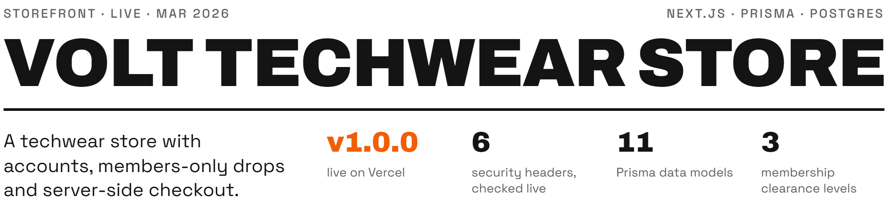

<picture>
  <source media="(max-width: 600px) and (prefers-color-scheme: dark)" srcset=".github/assets/header-phone-dark.png">
  <source media="(max-width: 600px) and (prefers-color-scheme: light)" srcset=".github/assets/header-phone-light.png">
  <source media="(prefers-color-scheme: dark)" srcset=".github/assets/header-dark.png">
  <source media="(prefers-color-scheme: light)" srcset=".github/assets/header-light.png">
  
</picture>

Volt is a techwear storefront where purchases earn Volt Points that raise a member's clearance level and unlock a members-only product vault, all run from a built-in admin panel. It is built on Next.js 15, Prisma 6 and Postgres with NextAuth accounts, and deployed on Vercel. Built by Daman (project lead) with Claude (architecture and UX) and Antigravity (implementation) as AI collaborators.

[Live store (v1.0.0)](https://volt-techwear-store.vercel.app) · [Portfolio page](https://damanjz.github.io/portfolio/projects/volt-techwear-store/)

## Results

| Figure | Result | How it is produced |
|---|---|---|
| Version | v1.0.0, live on Vercel | `package.json` version 1.0.0; commit `de4adba` "release: v1.0.0 (production hardened)", 2026-03-29; the live store answered HTTP 200 on 2026-10-12 |
| Security headers | 6 on every response | `securityHeaders` in `src/middleware.ts`; all six returned by `curl -I https://volt-techwear-store.vercel.app` on 2026-10-12 |
| Data models | 11 | `prisma/schema.prisma` (11 `model` blocks) |
| Clearance levels | 3: Lvl 1 (default), Lvl 2 at 5,000 VP, Lvl 3 at 15,000 VP | `CLEARANCE_THRESHOLDS` in `src/lib/actions/constants.ts` |
| Volt Points rate | 10% of the order total | `VOLT_POINTS_RATE = 0.1` in `src/lib/actions/constants.ts` |
| Rate limits | 40 requests per 10 s per IP; 5 per 10 s on register and verify | `src/middleware.ts`: Upstash Redis sliding window, in-memory fallback when Redis is not configured or fails |

## How it works

| Layer | What it does |
|---|---|
| App | Next.js 15 App Router on React 19 server components; Zustand (persisted) holds the cart, theme and user state on the client |
| Data | Prisma 6: PostgreSQL (Neon) in production, SQLite locally; `scripts/db-toggle.mjs` swaps the datasource block |
| Auth | NextAuth v4, credentials provider, JWT sessions; role, points and clearance are re-read from the database whenever the session is updated (`src/lib/auth.ts`) |
| Checkout | One Prisma `$transaction`: stock is decremented by an `updateMany` guarded by `stock >= quantity`, prices and coupon discounts are recalculated on the server, and each `OrderItem` keeps a snapshot of the product name and price in integer cents |
| Loyalty | Orders earn 10% of the total in Volt Points; crossing a threshold promotes the member to the next clearance level; Lvl 3 opens the Black Site vault of classified products |
| Theme | The `ThemeLoader` server component reads colours from `SiteConfig` and injects them as CSS variables, so admins can re-theme the live store |
| Middleware | Rate limiting, the six security headers and the route guards below, on every request |

### Data models

| Model | Purpose |
|---|---|
| `User` | Accounts with `role`, `voltPoints`, `clearanceLevel`, `isBanned` |
| `Product` | Inventory with `isActive`, `isClassified`, `tags`, stock tracking; prices in integer cents |
| `Order` / `OrderItem` | Purchase records with discount and coupon tracking; items snapshot name and price |
| `Coupon` / `CouponProduct` | Discount engine: percent or flat, site-wide, category or product scope, usage limits, expiry |
| `SiteConfig` | Live key-value config for theme, feature flags and banners |
| `ActivityLog` | Audit trail of every admin mutation (user, action, target, details) |
| `Account` / `Session` / `VerificationToken` | NextAuth internals and email verification tokens |

## Security model

| Route | Protection |
|---|---|
| `/admin/*` | `ADMIN` role only; signed-out users go to `/membership`, other roles to `/` |
| `/profile` | Signed-in users only; others go to `/membership` |
| `/api/debug/*` | Returns 404 when `NODE_ENV=production` |
| `/admin/*`, `/profile` | Banned users are redirected to `/membership?error=suspended` |

Security headers, set in `src/middleware.ts` on every response:

- `Content-Security-Policy` (`default-src 'self'`, plus the script, style, image, font and connect sources the app needs)
- `Strict-Transport-Security: max-age=63072000; includeSubDomains; preload` (two years)
- `X-Frame-Options: DENY`
- `X-Content-Type-Options: nosniff`
- `Referrer-Policy: strict-origin-when-cross-origin`
- `Permissions-Policy: camera=(), microphone=(), geolocation=()`

Other measures:

- Registration validates the email, takes 8 to 128 character passwords hashed with bcrypt (cost 12), and requires email verification before sign-in. In this demo the verification link is printed to the server console instead of being emailed.
- Accounts come only from registration; automatic account creation on first sign-in was removed.
- `robots.ts` disallows `/admin/`, `/api/`, `/profile` and `/black-site/`; `sitemap.ts` lists only active, non-classified products.
- Strict TypeScript, checked with `npm run typecheck`; Vitest unit tests cover the order, cart, clearance and admin actions.

## Admin panel

`/admin`, for users with `role = "ADMIN"` only. Every mutation is written to `ActivityLog`.

| Panel | Capabilities |
|---|---|
| Dashboard | Revenue, order, product and user counts, low-stock alerts, recent orders |
| Products | Create, edit, delete; toggle active; stock warnings; classified (Black Site) flag |
| Coupons | Create, delete, toggle; percent or flat; site-wide, category or product scope; usage limits; expiry dates |
| Users | Promote or demote roles, adjust clearance, edit Volt Points, ban or unban |
| Theme | Live colour editor for `--volt`, `--cyber-red`, background and foreground, stored in `SiteConfig` |
| Config | Key-value editor for feature flags, promotional banners and pricing multipliers, with presets |

## Design system

| Token | Light | Dark | Use |
|---|---|---|---|
| `--volt` | `#a3cc00` | `#d4ff33` | Primary accent: calls to action, highlights |
| `--cyber-red` | `#e11d48` | `#ff1a4f` | Alerts, restricted access, destructive actions |
| `--background` | `#f4f4f5` | `#0a0a0a` | Page background |
| `--foreground` | `#18181b` | `#ffffff` | Text |

Type: Inter (text), Outfit (display), Roboto Mono (labels), loaded with `next/font`. Effects: glass panels, an animated particle background, a crosshair cursor and terminal-style toasts, built with Tailwind CSS 4 and Framer Motion.

## Quick start

Requirements: Node 18.18 or later (Next.js 15), npm. Locally the store runs on SQLite, so no database server is needed.

```bash
git clone https://github.com/damanjz/volt-techwear-store.git
cd volt-techwear-store
npm install
npm run db:dev          # switch the Prisma datasource to SQLite
npx prisma migrate dev  # create the local database
npm run typecheck
npm test
npm run dev             # http://localhost:3000
```

`.env` for local development:

```env
DATABASE_URL="file:./dev.db"
NEXTAUTH_SECRET="any-long-random-string"
NEXTAUTH_URL="http://localhost:3000"
```

Admin access and sample data, local only: register at `/membership`, open the verification link printed in the server console, then set that user's `role` to `ADMIN` in `npx prisma studio`. Signed in as that admin, `GET /api/debug/seed?key=<SEED_SECRET>` loads the products, coupons and site config, and upserts an admin from `ADMIN_EMAIL` and `SEED_ADMIN_PASSWORD` (both read from `.env`; the route is blocked in production).

Production (Vercel) needs `DATABASE_URL` (Neon PostgreSQL), `NEXTAUTH_SECRET` and `NEXTAUTH_URL`; `UPSTASH_REDIS_REST_URL` and `UPSTASH_REDIS_REST_TOKEN` are optional and turn on Redis rate limiting. `npm run build` switches to PostgreSQL, runs `prisma db push`, generates the client and builds Next.js. Vercel deploys from `master`.

## Repo layout

```
volt-techwear-store/
├── prisma/
│   ├── schema.prisma           # 11 models
│   └── seed.mjs                # older product seed (float prices, see Limits)
├── scripts/
│   └── db-toggle.mjs           # SQLite (dev) <-> PostgreSQL (prod) datasource switch
├── src/
│   ├── app/
│   │   ├── page.tsx            # home: hero, new arrivals, Syndicate teaser
│   │   ├── shop/               # product archive and product pages
│   │   ├── merch/              # accessories hub
│   │   ├── membership/         # sign-up and sign-in
│   │   ├── profile/            # Volt Points and clearance
│   │   ├── black-site/         # classified vault (Lvl 3)
│   │   ├── admin/              # products, coupons, users, theme, config
│   │   ├── api/auth/           # NextAuth handler, register, verify
│   │   ├── api/debug/seed/     # dev-only seeding route
│   │   ├── error.tsx, not-found.tsx
│   │   └── sitemap.ts, robots.ts
│   ├── components/             # Navbar, HeroSection, ProductCard, cart, ThemeLoader, ...
│   ├── lib/
│   │   ├── actions/            # checkout, cart validation, clearance (+ __tests__)
│   │   ├── admin-actions/      # admin CRUD with activity logging (+ __tests__)
│   │   ├── auth.ts             # NextAuth config: JWT with role in the session
│   │   ├── prisma.ts           # PrismaClient singleton
│   │   └── store.ts            # Zustand store
│   ├── middleware.ts           # rate limits, security headers, route guards
│   └── types/next-auth.d.ts    # session type extensions
└── next.config.mjs             # remote image hosts
```

## Limits

- A portfolio demo store: there is no payment provider, so orders are recorded without taking payment.
- Verification emails are not sent; the link is printed to the server console.
- No CI workflow yet: tests and type checks run locally only. No coverage figure or third-party audit is claimed.
- Without Upstash Redis, rate limiting falls back to an in-memory counter per server instance.
- The production build uses `prisma db push --accept-data-loss`, not versioned migrations.
- `prisma/seed.mjs` predates integer-cent prices; seed through `/api/debug/seed` instead.

## Licence

MIT, see [LICENSE](LICENSE).
